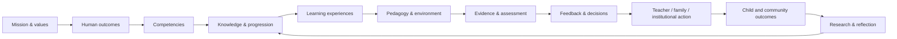
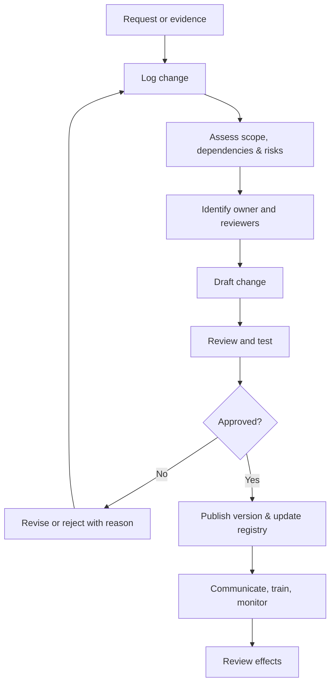

<!-- RAM-000 | Initial canonical markdown | Status: DRAFT -->
# RAM-000 — MASTER CONTROL & DOCUMENT ARCHITECTURE
## Blueprint induk, kendali dokumen, dependensi, kualitas, dan evolusi RA AL-MUNAWAROH OS

**Document ID:** RAM-000  
**Version:** 0.1.0  
**Status:** DRAFT — baseline arsitektur awal; belum melalui persetujuan formal  
**Owner role:** Architecture Owner / Repository Steward  
**Accountable governance:** RAM-013 (setelah artefak RAM-013 tersedia dan ditetapkan)  
**Primary artifact:** `RAM-000_MASTER_CONTROL_DOCUMENT_ARCHITECTURE.md`  
**Related artifacts:** `README.md`, `MASTER_WORK_ROADMAP.md`, `00-MASTER-CONTROL/registries/DOCUMENT_REGISTRY.md`

> **Tujuan dokumen:** menetapkan cara semua dokumen, kebijakan, praktik, bukti, proses, dan komponen digital RA AL-MUNAWAROH saling terhubung serta dikendalikan. Dokumen ini merupakan rancangan arsitektur, bukan bukti bahwa seluruh modul telah dibangun, disahkan, atau dijalankan.

## 1. Mandat

RAM-000 menjadi pengendali arsitektur dan tata dokumen untuk RA AL-MUNAWAROH OS. Ia menjaga satu sumber kebenaran, keterlacakan dari misi ke praktik, konsistensi istilah, kontrol versi, transparansi status, dan kesinambungan pengetahuan.

RAM-000 tidak menggantikan penilaian profesional, persetujuan pimpinan, kewajiban hukum, atau kebijakan perlindungan anak. Jika ada konflik antara dokumen, jangan mengubahnya diam-diam; catat konflik, risiko, pemilik keputusan, dan hasil resolusinya.

## 2. Prinsip arsitektur

1. **One source of truth:** satu artefak kanonis per tujuan; duplikat harus ditandai sebagai salinan atau turunan.
2. **Child-first by design:** keselamatan, martabat, perkembangan, privasi, dan kepentingan terbaik anak merupakan kendala lintas sistem.
3. **Traceability:** setiap tujuan, praktik, indikator, keputusan, dan fitur digital harus memiliki alasan serta hubungan yang dapat ditelusuri.
4. **Evidence-aware:** nilai/norma, kewajiban hukum, temuan empiris, praktik menjanjikan, asumsi, dan hipotesis dibedakan.
5. **Human accountability:** AI dapat membantu merancang, mengorganisasi, atau meninjau; keputusan berisiko tinggi tetap berada pada manusia berwenang.
6. **Minimum necessary data:** data pribadi hanya dikumpulkan dan dibagikan bila diperlukan, dengan dasar, akses, dan retensi yang jelas.
7. **Modular but connected:** setiap OS memiliki mandat khusus, kontrak antarmodul, dependensi, dan artefak turunan.
8. **Developmentally appropriate:** kerangka harus diterjemahkan ke pengalaman yang sesuai usia, konteks, dan kebutuhan dukungan anak.
9. **Reversible learning:** pilot dan eksperimen memiliki tujuan, perlindungan, ukuran hasil, serta kriteria untuk berhenti atau memperbaiki.
10. **Stewardship:** sistem harus dapat dipahami, dirawat, dan diwariskan oleh orang yang bukan pembuat awalnya.

## 3. Lapisan arsitektur

| Lapisan | Fungsi | Artefak tipikal |
|---|---|---|
| L0 — Mission & Covenant | Misi, nilai, komitmen, batas yang tidak boleh dilanggar | RAM-001, RAM-024 |
| L1 — Human Development | Model perkembangan manusia dan anak | RAM-002, RAM-009, RAM-018 |
| L2 — Knowledge & Curriculum | Pengetahuan, kompetensi, progresi, pengalaman belajar | RAM-003, RAM-004 |
| L3 — Pedagogy & Evidence | Praktik belajar, asesmen, bukti, umpan balik | RAM-005, RAM-006, RAM-012 |
| L4 — Human Systems | Guru, keluarga, tenaga kerja, komunitas | RAM-007, RAM-008, RAM-016, RAM-019 |
| L5 — Environment & Technology | Kampus, bahan, teknologi, AI, data | RAM-010, RAM-011 |
| L6 — Institution & Operations | Tata kelola, layanan, keuangan, mutu, risiko | RAM-013, RAM-014, RAM-015, RAM-020 |
| L7 — Ecosystem & Legacy | Merek, kemitraan, replikasi, warisan | RAM-021, RAM-022, RAM-023, RAM-024 |
| Cross-cutting controls | Perlindungan, etika, aksesibilitas, privasi, keselamatan | RAM-017, RAM-020; diterapkan pada seluruh lapisan |

## 4. Peta master RAM-000–RAM-024

| ID | Modul | Mandat utama | Dependensi kunci |
|---|---|---|---|
| RAM-000 | Master Control & Document Architecture | Arsitektur, registry, kontrol dokumen, mutu | Semua modul |
| RAM-001 | Foundational Constitution OS | Misi, nilai, prinsip, batas normatif | Konteks lembaga |
| RAM-002 | Grand Human Development Model | Model perkembangan holistik manusia | RAM-001, 009, 018 |
| RAM-003 | Knowledge & Islamic-Universal Knowledge OS | Peta pengetahuan dan hubungan disiplin | RAM-001, 002 |
| RAM-004 | Curriculum OS | Hasil belajar, kompetensi, progresi, unit | RAM-002, 003, 005, 006 |
| RAM-005 | Pedagogy & Learning OS | Desain pengalaman dan praktik pembelajaran | RAM-002, 004, 006, 007 |
| RAM-006 | Assessment & Evidence OS | Observasi, bukti, umpan balik, keputusan | RAM-002, 004, 005, 009 |
| RAM-007 | Teacher OS | Kompetensi dan praktik guru | RAM-005, 006, 016, 017 |
| RAM-008 | Parent & Family OS | Kemitraan keluarga dan pembelajaran di rumah | RAM-004, 006, 009, 017 |
| RAM-009 | Child Development & Wellbeing OS | Profil perkembangan dan dukungan anak | RAM-002, 006, 017, 018 |
| RAM-010 | Learning Environment & Campus OS | Ruang, material, alam, aksesibilitas, fasilitas | RAM-009, 014, 017, 018, 020 |
| RAM-011 | Technology & AI OS | Arsitektur digital, AI, data, keamanan | RAM-012, 013, 017, 020 |
| RAM-012 | Research, Evidence & Innovation OS | Riset, pilot, pembelajaran organisasi | RAM-003–006, 013, 020 |
| RAM-013 | Governance, Leadership & Institutional OS | Akuntabilitas, keputusan, pengawasan | RAM-001, 014, 015, 020 |
| RAM-014 | Operations, Quality & Service Excellence OS | SOP, layanan, mutu, perbaikan | RAM-007–010, 013, 015, 017, 020 |
| RAM-015 | Finance, Sustainability & Resource Stewardship OS | Anggaran, sumber daya, keberlanjutan | RAM-013, 014, 020 |
| RAM-016 | People, Talent & Organizational Culture OS | SDM, kompetensi, budaya, suksesi | RAM-007, 013, 014, 015, 017 |
| RAM-017 | Safeguarding, Child Protection & Ethics OS | Perlindungan anak, etik, pelaporan | Seluruh modul |
| RAM-018 | Health, Nutrition, Physical Development & Wellbeing OS | Kesehatan, nutrisi, gerak, kesejahteraan | RAM-009, 010, 017, 020 |
| RAM-019 | Community, Service & Civilization OS | Komunitas, layanan, kontribusi sesuai usia | RAM-001, 008, 013, 022 |
| RAM-020 | Risk, Resilience, Safety & Business Continuity OS | Risiko, keselamatan, insiden, kesinambungan | RAM-013–018 |
| RAM-021 | Brand, Communication & Storytelling OS | Identitas, komunikasi, narasi bertanggung jawab | RAM-001, 013, 017, 022 |
| RAM-022 | Partnerships & Ecosystem OS | Mitra, kesepakatan, pengelolaan ekosistem | RAM-013, 019, 021, 023 |
| RAM-023 | Replication, Scaling & Globalization OS | Replikasi berbasis mutu dan konteks | RAM-012–015, 020–022 |
| RAM-024 | Legacy, Alumni & 100-Year Covenant OS | Warisan, suksesi, memori institusi | RAM-001, 012, 013, 019, 023 |

Peta ini adalah arsitektur sasaran. Status ketersediaan setiap modul ditentukan oleh Document Registry, bukan oleh keberadaan nama di tabel ini.

## 5. Rantai keterlacakan utama

Setiap hubungan harus dijelaskan pada tingkat yang sesuai. Jangan membuat klaim kausal hanya karena dua indikator berubah bersamaan. Catat faktor konteks, keterbatasan, dan kemungkinan penjelasan lain.

## 6. Document DNA dan standar metadata

Setiap dokumen kanonis memuat metadata berikut di bagian awal:

- Document ID dan judul kanonis.
- Versi, status, tanggal dibuat/diubah.
- Owner role, reviewer role, approver role jika berlaku.
- Tujuan, ruang lingkup, pengguna, dan pengecualian.
- Istilah utama dan definisi.
- Komitmen normatif, kewajiban, klaim empiris, praktik menjanjikan, asumsi, dan hipotesis.
- Dependensi dan artefak turunan.
- Peran, keputusan, risiko, kontrol, eskalasi.
- Pertimbangan safeguarding, privasi, keamanan, aksesibilitas, dan retensi.
- SOP, template, checklist, instrumen, pelatihan, atau komponen digital yang diperlukan.
- Ukuran keberhasilan, sumber bukti, keterbatasan, jadwal review.
- Change log dan tautan ke dokumen terkait.

## 7. Konvensi ID, nama file, dan versi

**ID modul:** `RAM-###`  
**ID artefak turunan:** `RAM-###-ART-###` atau skema yang disetujui Document Controller.  
**Nama file:** gunakan ID, kata kunci jelas, dan ekstensi sesuai jenis artefak. Hindari nama generik seperti `final-final-baru.md`.

Contoh:
- `RAM-004_CURRICULUM_OS.md`
- `RAM-004-ART-001_UNIT_PLAN_TEMPLATE.md`
- `RAM-006-ART-002_OBSERVATION_GUIDE.md`

**Versi semantik yang disarankan:**
- Major (1.0 → 2.0): perubahan struktur, kebijakan, atau makna yang berdampak besar.
- Minor (1.0 → 1.1): penambahan kemampuan atau isi yang kompatibel.
- Patch (1.0.0 → 1.0.1): koreksi kecil tanpa mengubah maksud.
- Status scaffold/draft tetap dicantumkan sampai ada review; nomor versi tidak berarti persetujuan.

## 8. Model status

| Status | Syarat |
|---|---|
| PLANNED | Kebutuhan dikenal, artefak belum tersedia atau belum diverifikasi |
| SCAFFOLD | Kerangka awal tersedia |
| DRAFT | Isi substantif tersedia, belum disetujui |
| IN_REVIEW | Sedang menjalani review yang tercatat |
| APPROVED | Disetujui pemilik berwenang dengan bukti |
| PILOT | Diuji terbatas dengan protokol dan perlindungan |
| ACTIVE | Disahkan untuk penggunaan rutin pada lingkup tertentu |
| REVISE | Memerlukan perbaikan |
| RETIRED | Digantikan; arsip dan rujukan tetap dijaga |

## 9. Gerbang mutu dokumen

Sebelum status dinaikkan, reviewer memeriksa:

1. **Purpose:** kebutuhan dan hasil yang diinginkan jelas.
2. **Traceability:** hubungan ke misi, kompetensi, proses, dan artefak terkait jelas.
3. **Integrity:** sumber dan jenis klaim dinyatakan; tidak ada klaim palsu tentang bukti atau persetujuan.
4. **Operationality:** ada alur, pemilik, keputusan, contoh, dan tindakan yang bisa dijalankan.
5. **Safety:** risiko anak, privasi, aksesibilitas, dan keselamatan ditangani.
6. **Feasibility:** waktu, kapasitas, sumber daya, dan beban administrasi realistis.
7. **Measurement:** cara menilai manfaat, efek samping, dan keterbatasan jelas.
8. **Maintainability:** pemilik, versi, review date, change log, dan dependensi tercatat.
9. **Human review:** keputusan yang berdampak tinggi diperiksa manusia berwenang.
10. **User test:** bila sesuai, dokumen diuji keterpahaman dan kegunaannya pada skala terbatas.

## 10. Repository governance dan keamanan informasi

- GitHub adalah sumber dokumen kerja yang disetujui untuk disimpan di repository; jangan menyimpan data pribadi anak, keluarga, staf, catatan kesehatan, laporan insiden rahasia, kredensial, token, atau dokumen identitas.
- Artefak sensitif disimpan pada sistem yang disetujui dengan akses terbatas; repository publik hanya berisi kebijakan umum, template kosong, dan data agregat yang aman.
- Setiap file memiliki satu path kanonis. Salinan untuk publikasi harus menunjuk ke sumber dan tanggal ekspor.
- Review dan approval harus dapat dibuktikan. Label “approved” tidak boleh digunakan tanpa pemilik dan rekaman persetujuan.
- Perubahan pada perlindungan anak, data, keputusan berdampak tinggi, atau keselamatan memerlukan review relevan sebelum implementasi.
- Backup dan pemulihan repository perlu ditetapkan dalam RAM-020/RAM-011.

## 11. Registries yang mengendalikan sistem

Registry utama:
- **Document Registry** — status, path, pemilik, versi, dependensi.
- **Decision Register** — keputusan, opsi, alasan, pihak berwenang.
- **Evidence Register** — klaim, sumber, kualitas, relevansi, batas, tingkat keyakinan.
- **Assumption & Hypothesis Register** — hal yang belum diketahui dan rencana pengujian.
- **Risk Register** — risiko, kontrol, pemilik, trigger, eskalasi.
- **Change Register** — perubahan, dampak, keputusan, komunikasi.
- **Artifact & Dependency Map** — hubungan dokumen induk dan turunannya.

Buat registry tambahan hanya ketika ada pemilik, tujuan, dan prosedur pembaruan yang jelas. Jangan biarkan dua register menjadi sumber status yang saling bertentangan.

## 12. Alur perubahan

Perubahan yang mendesak demi keselamatan dapat memerlukan tindakan sementara sesuai kewenangan dan protokol; tindakan tersebut harus dicatat, ditinjau, dan tidak menjadi alasan untuk melewati akuntabilitas secara permanen.

## 13. Kualitas hubungan antarmodul

- RAM-004 tidak boleh menetapkan hasil belajar tanpa mempertimbangkan perkembangan anak pada RAM-002/RAM-009.
- RAM-005 tidak boleh menyarankan praktik tanpa batas keselamatan, aksesibilitas, dan dukungan yang relevan.
- RAM-006 tidak boleh mengubah observasi terbatas menjadi diagnosis atau label permanen.
- RAM-007 dan RAM-016 harus membedakan pengembangan kompetensi guru dari pengelolaan SDM secara luas.
- RAM-011 tidak boleh memperkenalkan pengumpulan data atau AI tanpa tujuan, kontrol, dan pemilik.
- RAM-013–RAM-015 menetapkan akuntabilitas, operasi, dan sumber daya; satu modul tidak boleh mengasumsikan persetujuan modul lain.
- RAM-017 dan RAM-020 adalah kontrol lintas sistem yang harus memengaruhi desain, bukan sekadar lampiran.
- RAM-023 hanya boleh mendorong replikasi praktik yang memiliki bukti dan batas konteks yang dijelaskan.
- RAM-024 menjaga jejak keputusan, pembelajaran, suksesi, dan warisan.

## 14. Website dan sistem digital

Website publik berfungsi menjelaskan misi, pendekatan, kemitraan, dan informasi layanan yang disetujui. Portal internal—jika dibangun—harus memisahkan peran dan akses untuk guru, keluarga, pengelola, dan administrator.

Prinsip desain:
- aksesibel, responsif, mudah dibaca, dan ramah perangkat;
- tidak mempublikasikan data atau gambar anak tanpa proses persetujuan dan perlindungan yang memadai;
- setiap formulir memiliki tujuan, pemilik, akses, retensi, dan jalur penanganan;
- fitur AI harus menjelaskan batas, sumber data, review manusia, dan fallback;
- animasi dan efek visual tidak boleh mengurangi keterbacaan, aksesibilitas, atau kinerja;
- dokumen kanonis tidak hanya disimpan di halaman website; repository dan registry tetap menjadi sumber kendali.

## 15. Dashboard arsitektur dan indikator

Indikator awal yang dapat digunakan setelah definisi dan baseline disepakati:
- proporsi dokumen dengan metadata lengkap;
- proporsi dokumen dengan pemilik dan dependensi tercatat;
- jumlah tautan/path rusak yang belum diperbaiki;
- status review dokumen berisiko tinggi;
- perubahan yang belum ditutup;
- artefak turunan yang belum memiliki sumber induk;
- temuan pilot yang belum ditindaklanjuti.

Jangan menetapkan target angka tanpa baseline. Jangan menggunakan banyaknya dokumen sebagai proksi tunggal kualitas sistem.

## 16. Definition of Done RAM-000

- [ ] Document Registry mencakup semua artefak kanonis yang ada dan statusnya diverifikasi.
- [ ] Semua modul memiliki mandat, dependensi, pemilik peran, dan status.
- [ ] Aturan versi, metadata, perubahan, review, dan approval disepakati.
- [ ] Jalur safeguarding, privasi, keamanan, dan eskalasi lintas modul ditautkan.
- [ ] Kriteria kualitas dan mekanisme evaluasi dapat diterapkan.
- [ ] Struktur repository dan link diperiksa.
- [ ] Ada bukti review dan persetujuan formal sebelum status menjadi APPROVED.

## 17. Change log

| Versi | Status | Perubahan | Otorisasi |
|---|---|---|---|
| 0.1.0 | DRAFT | Baseline arsitektur, peta RAM, metadata, status, gerbang mutu, registries, perubahan, dan kontrol lintas sistem | Belum ditinjau/disetujui formal |

---
**Brand steward:** Gugun Gunara — Sang Master Polymath · Sage Universal · The Ultimate Problem Solver  
**Management framework:** PT Digital Bisnis Manajemen — digiman.id  
**Strategic consulting framework:** PT Top Konsultan Internasional

*Pencantuman nama dan peran di atas merupakan kerangka branding yang diarahkan; kewenangan dan hubungan hukum mengikuti dokumen resmi yang berlaku.*
