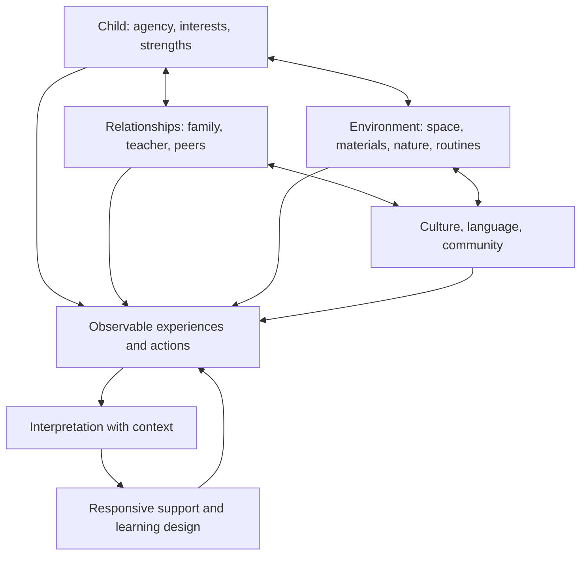

<!-- RAM-002 | Version 0.1.0 | Status: DRAFT -->
# RAM-002 — GRAND HUMAN DEVELOPMENT MODEL
## Model perkembangan holistik manusia sebagai fondasi pengalaman pendidikan RA AL-MUNAWAROH

**Document ID:** RAM-002  
**Version:** 0.1.0  
**Status:** DRAFT — kerangka konseptual awal; perlu review ahli, kesesuaian dengan standar yang berlaku, dan validasi kontekstual  
**Owner role:** Human Development Framework Lead  
**Accountable governance:** RAM-013  
**Primary dependencies:** RAM-001, RAM-000  
**Related modules:** RAM-004, RAM-005, RAM-006, RAM-007, RAM-008, RAM-009, RAM-017, RAM-018

> **Batas penggunaan:** model ini adalah kerangka pendidikan dan refleksi, bukan alat diagnosis klinis, instrumen psikometri tervalidasi, atau pengganti penilaian tenaga profesional. Tahap dan domain di bawah tidak boleh digunakan untuk memberi label permanen, membandingkan nilai anak, atau membuat keputusan berisiko tinggi tanpa prosedur yang sesuai.

## 1. Purpose

RAM-002 menjelaskan dimensi perkembangan manusia yang perlu dipertimbangkan saat merancang pengalaman belajar, dukungan, lingkungan, kemitraan keluarga, dan evaluasi program. Model ini membantu mencegah penyempitan pendidikan menjadi capaian akademik tunggal.

Model mengakui bahwa perkembangan bersifat multidimensional, saling terkait, dipengaruhi relasi dan konteks, dan tidak selalu bergerak secara linear. Anak dapat menunjukkan kemampuan yang berbeda pada situasi, bahasa, hubungan, atau hari yang berbeda.

## 2. Prinsip perkembangan

1. **Holistik:** perkembangan fisik, emosional, sosial, bahasa, kognitif, moral/spiritual, kreativitas, dan kemandirian saling memengaruhi.
2. **Relasional:** rasa aman, hubungan responsif, keluarga, guru, dan komunitas membentuk konteks perkembangan.
3. **Bervariasi:** ada variasi individual; satu pola tidak cocok untuk semua anak.
4. **Bertahap tetapi tidak linear:** kemajuan dapat maju-mundur, tidak merata, dan dipengaruhi konteks.
5. **Play and exploration:** bermain, gerak, percakapan, cerita, seni, alam, dan eksplorasi konkret merupakan pengalaman penting untuk anak usia dini.
6. **Strengths-based:** mulai dari minat, kekuatan, kemampuan, dan dukungan yang membantu; jangan mendefinisikan anak dari kekurangan.
7. **Culture and language aware:** bahasa, keluarga, budaya, pengalaman, dan konteks sosial perlu dipahami.
8. **Inclusive:** lingkungan dan pengalaman disesuaikan agar anak dengan kebutuhan berbeda dapat berpartisipasi.
9. **Observation, not diagnosis:** observasi pendidikan membantu perencanaan dan komunikasi; bukan diagnosis medis/psikologis.
10. **Protective:** keselamatan, privasi, martabat, dan safeguarding berlaku pada semua domain.
11. **Evidence-aware:** model konseptual harus ditinjau terhadap bukti dan standar relevan; jangan menyamakan rancangan internal dengan konsensus ilmiah.
12. **Family partnership:** interpretasi perkembangan dibangun melalui dialog dengan keluarga, bukan asumsi satu pihak.

## 3. Peta domain perkembangan

| Domain | Fokus pendidikan | Contoh kesempatan yang sesuai usia | Batas interpretasi |
|---|---|---|---|
| Spiritual, meaning & values | Rasa syukur, makna, kebiasaan ibadah/adab sesuai usia, kebaikan | Cerita, teladan, rutinitas sederhana, berbagi | Jangan memaksa ekspresi emosional atau menilai iman dari satu perilaku |
| Physical & motor | Gerak kasar/halus, koordinasi, kesadaran tubuh | Berlari aman, menyeimbangkan, menggambar, meronce sesuai kesiapan | Bukan diagnosis kesehatan atau perkembangan motorik |
| Health & self-care | Kebiasaan sehat, kebersihan, istirahat, mengenali kebutuhan tubuh | Cuci tangan, makan bersama, mengenali haus/lelah | Kebutuhan medis ditangani oleh pihak kompeten |
| Language & communication | Mendengar, berbicara, bercerita, bahasa keluarga dan bahasa pembelajaran | Percakapan, lagu, buku, drama, bercerita | Perbedaan bahasa bukan otomatis keterlambatan |
| Cognitive & reasoning | Mengamati, membandingkan, mengelompokkan, mengingat, memecahkan masalah | Eksperimen sederhana, teka-teki konkret, permainan aturan | Jangan menyimpulkan kemampuan umum dari satu tugas |
| Social relationships | Bergiliran, bekerja sama, memahami perspektif, memperbaiki konflik | Permainan kelompok, proyek bersama, dialog terpandu | Perilaku sosial dipengaruhi situasi dan dukungan |
| Emotional awareness & regulation | Mengenali perasaan, mencari bantuan, pulih setelah frustrasi | Cerita emosi, co-regulation, sudut tenang | Jangan menuntut regulasi mandiri sebelum dukungan memadai |
| Executive function & agency | Perhatian, memori kerja, fleksibilitas, perencanaan sederhana, pilihan | Permainan aturan, tugas beberapa langkah, pilihan terbatas | Kemampuan berubah sesuai konteks, stres, dan usia |
| Creativity & expression | Imajinasi, ekspresi, ide, desain, seni, musik, gerak | Menggambar bebas, konstruksi, musik, permainan peran | Jangan menilai kreativitas dari satu produk atau gaya |
| Character & ethical action | Kejujuran, tanggung jawab bertahap, empati, perbaikan | Merawat alat, meminta maaf dengan dukungan, membantu teman | Hindari label “anak baik/buruk”; fokus pada tindakan dan konteks |
| Nature & systems awareness | Mengamati lingkungan, hubungan sebab-akibat sederhana, kepedulian | Merawat tanaman, mengamati air/cuaca, memilah bahan | Jelaskan batas pengamatan dan hindari klaim yang tidak diuji |
| Digital & media foundations | Pendampingan orang dewasa, keamanan dasar, keseimbangan | Penggunaan terbatas untuk tujuan jelas dan bersama orang dewasa | Tidak menggantikan permainan, relasi, tidur, gerak, atau pengalaman nyata |

Domain ini adalah peta desain untuk membantu perencanaan, bukan daftar skor yang wajib diberikan kepada setiap anak.

## 4. Model integrasi

Perkembangan tidak boleh dipahami sebagai sifat anak semata. Perilaku yang terlihat juga dipengaruhi oleh kesempatan, tuntutan tugas, bahasa, relasi, aksesibilitas, kesehatan, rasa aman, dan lingkungan.

## 5. Perjalanan perkembangan untuk desain pembelajaran

Tahap berikut adalah **lensa desain pengalaman**, bukan tahap klinis atau standar universal yang menggantikan kurikulum dan standar perkembangan resmi. Usia dan kesiapan aktual perlu dipertimbangkan.

| Lensa | Pertanyaan pendidik | Contoh dukungan |
|---|---|---|
| Safety & connection | Apakah anak merasa aman dan memiliki hubungan yang responsif? | Rutinitas konsisten, sambutan hangat, co-regulation |
| Wonder & exploration | Apa yang menarik perhatian dan pertanyaan anak? | Bahan konkret, alam, cerita, pilihan sederhana |
| Language & meaning | Bagaimana anak mengungkapkan pengalaman dan menghubungkannya dengan ide? | Percakapan, cerita ulang, gambar, bahasa keluarga |
| Practice & collaboration | Keterampilan apa yang sedang dilatih dan dengan dukungan apa? | Pemodelan, pengulangan bermakna, permainan bersama |
| Creation & agency | Pilihan atau karya apa yang dapat dibuat anak? | Proyek sederhana, konstruksi, seni, pemecahan masalah |
| Reflection & transfer | Apa yang anak perhatikan, ingat, atau coba pada situasi lain? | Pertanyaan sederhana, dokumentasi proses, kegiatan tindak lanjut |
| Contribution & care | Bagaimana anak berpartisipasi dalam kebaikan sesuai usia? | Merawat ruang, berbagi alat, membantu dengan pendampingan |

## 6. Prinsip observasi dan dokumentasi

Observasi pendidikan harus menggambarkan apa yang benar-benar terlihat atau terdengar, konteksnya, dukungan yang diberikan, dan kemungkinan langkah berikutnya.

### Format catatan observasi yang disarankan
- Tanggal/konteks menggunakan identitas minimal yang diperlukan pada sistem privat yang disetujui.
- Situasi dan aktivitas.
- Deskripsi perilaku/ucapan yang dapat diamati tanpa interpretasi berlebihan.
- Minat, kekuatan, dan strategi anak.
- Dukungan lingkungan atau orang dewasa yang diberikan.
- Interpretasi sementara beserta alternatif penjelasan.
- Pertanyaan atau langkah berikutnya.
- Apakah perlu berdialog dengan keluarga atau meminta konsultasi pihak kompeten.
- Klasifikasi privasi, pemilik, akses, dan retensi.

Jangan menyimpan data identitas anak atau catatan observasi individual di repository publik. Template kosong boleh disimpan; catatan nyata berada di sistem dengan kontrol akses yang tepat.

## 7. Dukungan dan diferensiasi

Rancang dukungan berdasarkan kebutuhan yang diamati dan konteks, bukan label tetap.

- **Universal support:** rutinitas yang jelas, hubungan hangat, bahasa sederhana, pilihan yang masuk akal, material beragam, dan lingkungan aman.
- **Targeted support:** penyesuaian terarah untuk keterampilan atau situasi tertentu, disepakati dengan pihak relevan dan ditinjau.
- **Specialist consultation/referral:** ketika ada kekhawatiran yang menetap, berdampak, atau membutuhkan keahlian di luar kompetensi pendidik; ikuti prosedur dan persetujuan yang berlaku.
- **Review:** catat apakah dukungan membantu, apakah hambatan lingkungan masih ada, dan apakah strategi perlu diubah.

Pendidik tidak membuat diagnosis klinis atau menghentikan dukungan hanya karena anak tidak segera menunjukkan perubahan.

## 8. Keterkaitan dengan kurikulum dan asesmen

- **RAM-004:** menerjemahkan domain ke tujuan dan pengalaman yang relevan bagi konteks RA.
- **RAM-005:** memilih praktik, interaksi, bahan, dan dukungan yang sesuai.
- **RAM-006:** mengumpulkan bukti yang beragam, memberikan umpan balik, dan menjaga batas interpretasi.
- **RAM-007:** membangun kompetensi guru dalam observasi, relasi, diferensiasi, dan refleksi.
- **RAM-008:** mengintegrasikan pengetahuan keluarga dan pengalaman rumah tanpa menyalahkan.
- **RAM-009:** mengoperasionalkan profil perkembangan dan dukungan individual.
- **RAM-017:** menetapkan safeguards, pelaporan, privasi, dan batas peran.
- **RAM-018:** mengatur kesehatan, nutrisi, gerak, dan rujukan sesuai kewenangan.

## 9. Prinsip asesmen yang selaras

1. Gunakan beberapa kesempatan dan konteks sebelum menyimpulkan pola.
2. Pisahkan observasi dari interpretasi.
3. Fokus pada kemajuan, strategi, minat, dan dukungan yang efektif.
4. Hindari pemeringkatan anak sebagai identitas tetap.
5. Gunakan bahasa yang menghormati dan dapat dipahami keluarga.
6. Catat keterbatasan bukti dan kemungkinan faktor kontekstual.
7. Jangan mengumpulkan data hanya karena bisa; tetapkan tujuan dan retensi.
8. Keputusan terkait kesehatan atau diagnosis dirujuk kepada profesional berwenang.

## 10. Risiko salah penggunaan model

| Risiko | Pencegahan |
|---|---|
| Model menjadi daftar label anak | Gunakan sebagai lensa desain dan dukungan, bukan klasifikasi permanen |
| Perkembangan diperlakukan linear | Catat variasi, konteks, dan kemajuan yang tidak merata |
| Guru mendiagnosis dari observasi | Tegaskan batas peran dan jalur konsultasi |
| Bias bahasa/budaya | Dokumentasikan konteks dan konsultasikan dengan keluarga |
| Data anak tersebar | Sistem privat, akses berbasis peran, minimisasi data |
| Target akademik menggeser bermain | Audit pengalaman harian dan beban tugas |
| Skor tunggal menentukan keputusan | Bukti multipel, dialog, dan review manusia |
| Klaim ilmiah berlebihan | Evidence Register, sumber, kualitas, dan keterbatasan |

## 11. Pertanyaan riset dan validasi

Sebelum model dipakai secara formal, tim perlu:
- membandingkan domain dengan standar kurikulum dan perkembangan yang berlaku;
- meninjau sumber ilmiah dan pedoman profesional yang relevan;
- memeriksa keterwakilan bahasa, budaya, aksesibilitas, dan kebutuhan dukungan;
- meminta review dari pendidik dan ahli relevan;
- menguji apakah template observasi membantu guru tanpa menambah beban berlebihan;
- menilai risiko privasi dan safeguarding;
- mencatat perubahan model berdasarkan bukti dan konteks.

## 12. Definition of Done

- [ ] Domain dan istilah didefinisikan dengan batas interpretasi.
- [ ] Sumber dan landasan empiris yang relevan ditambahkan ke Evidence Register.
- [ ] Kesesuaian dengan standar resmi dan konteks lokal ditinjau.
- [ ] Hubungan dengan RAM-004–RAM-009 dan RAM-017–RAM-018 diuji.
- [ ] Template observasi privat dan panduan komunikasi keluarga ditinjau.
- [ ] Protokol rujukan dan batas kompetensi jelas.
- [ ] Ada review ahli/pemangku kepentingan dan persetujuan formal sebelum status dinaikkan.
- [ ] Risiko penggunaan sebagai diagnosis atau pemeringkatan telah dimitigasi.

## 13. Change log

| Versi | Status | Perubahan | Otorisasi |
|---|---|---|---|
| 0.1.0 | DRAFT | Peta domain, model relasional, lensa perkembangan, observasi, dukungan, risiko, dan validasi | Belum ditinjau/disetujui formal |

---
**Brand steward:** Gugun Gunara — Sang Master Polymath · Sage Universal · The Ultimate Problem Solver.
