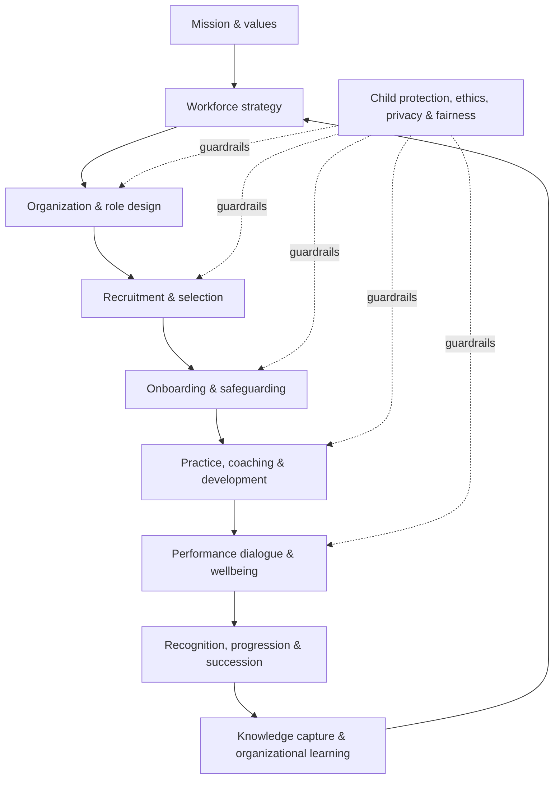
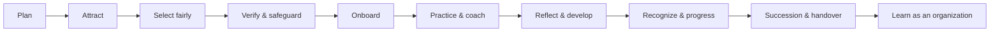
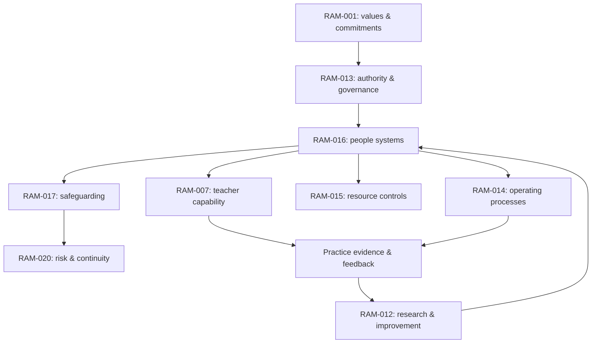

<!-- RAM-016 | Scaffold v0.1 | Status: SCAFFOLD | Review required -->
# RAM-016 — PEOPLE, TALENT & ORGANIZATIONAL CULTURE OS
## Sistem manusia, kompetensi, kepemimpinan, dan budaya organisasi RA AL-MUNAWAROH

**Document ID:** RAM-016  
**Version:** 0.1.0-scaffold  
**Status:** SCAFFOLD — kerangka awal, belum disetujui dan belum tervalidasi untuk penggunaan operasional  
**Owner role:** People & Culture Lead (ditetapkan oleh tata kelola)  
**Accountable governance:** RAM-013  
**Primary dependencies:** RAM-001, RAM-007, RAM-013, RAM-014, RAM-015, RAM-017, RAM-020  
**Related systems:** RAM-002, RAM-006, RAM-008, RAM-009, RAM-011, RAM-012, RAM-018, RAM-021, RAM-022  
**Intended users:** pimpinan lembaga, pengelola SDM, kepala RA, guru, staf pendukung, mentor, serta reviewer berwenang.

> **Peringatan status:** dokumen ini adalah kerangka kerja yang harus dilengkapi, ditinjau, disesuaikan dengan hukum dan kebijakan yang berlaku, serta diuji secara bertanggung jawab. Dokumen ini bukan nasihat hukum/ketenagakerjaan dan tidak menetapkan ketentuan kontrak, gaji, atau kewenangan tanpa data dan persetujuan resmi.

## 1. Mandat dan hasil yang diharapkan

RAM-016 memastikan lembaga memiliki orang yang tepat, dukungan yang adil, kompetensi yang relevan, budaya kerja yang sehat, dan sistem pengembangan yang menjaga kualitas pendidikan serta perlindungan anak.

Sistem SDM tidak boleh memperlakukan guru sebagai mesin pelaksana, mengukur nilai manusia hanya melalui angka, atau mendorong target yang mengorbankan keselamatan, martabat, dan perkembangan anak.

### Hasil organisasi yang dituju
1. Peran, akuntabilitas, dan batas kewenangan jelas.
2. Rekrutmen adil, relevan dengan pekerjaan, dan berorientasi pada keselamatan anak.
3. Kompetensi dikembangkan melalui praktik, coaching, refleksi, dan bukti yang proporsional.
4. Kinerja dinilai dengan konteks, dialog, dan tindak lanjut yang dapat dijalankan.
5. Beban kerja, kesejahteraan, inklusi, dan suara staf diperhatikan.
6. Budaya nilai tampak dalam keputusan dan perilaku sehari-hari.
7. Pengetahuan organisasi terdokumentasi dan dapat diwariskan tanpa bergantung pada satu orang.

## 2. Prinsip desain

- **Amanah dan adab:** integritas, kejujuran, rasa hormat, tanggung jawab, dan keteladanan.
- **Rahmah dan keadilan:** manusia diperlakukan bermartabat; proses konsisten dan dapat dijelaskan.
- **Child-first:** setiap keputusan SDM yang memengaruhi anak menilai dampak dan risiko bagi anak.
- **Professional growth:** pembinaan dan peningkatan kompetensi diutamakan; tindakan korektif tetap adil ketika diperlukan.
- **Evidence-aware:** pisahkan komitmen nilai, kewajiban hukum, temuan empiris, praktik menjanjikan, dan hipotesis.
- **Privacy by design:** akses data personal dibatasi berdasarkan kebutuhan dan kewenangan.
- **Accessibility and inclusion:** akomodasi yang layak dan proses yang tidak diskriminatif sesuai ketentuan yang berlaku.
- **No single-metric management:** tidak ada satu indikator yang cukup untuk menyimpulkan kualitas guru atau karyawan.
- **Human accountability:** keputusan berdampak tinggi tidak diserahkan sepenuhnya kepada AI atau sistem otomatis.
- **Sustainable workload:** target harus sesuai waktu, sumber daya, kompetensi, dan kebutuhan pemulihan.

## 3. Model sistem SDM

## 4. Lingkup sistem

| Domain | Pertanyaan kendali | Artefak operasional yang harus dikembangkan |
|---|---|---|
| Workforce planning | Kapasitas dan kompetensi apa yang dibutuhkan? | Workforce plan, capacity model |
| Organization design | Siapa memutuskan, melakukan, memeriksa, dan mengeskalasi? | Organization chart, role charter, RACI/decision matrix |
| Job architecture | Apa hasil kerja, ruang lingkup, dan batas peran? | Job family, role profile, job description |
| Competency architecture | Perilaku dan kemampuan apa yang relevan? | Competency dictionary, observable indicators |
| Recruitment & selection | Bagaimana memilih secara adil dan aman? | Recruitment SOP, structured interview, reference-check protocol |
| Onboarding | Apa yang harus dipahami sebelum menjalankan tugas? | Induction plan, safeguarding sign-off, 30/60/90-day plan |
| Professional development | Bagaimana kompetensi tumbuh? | Individual growth plan, coaching guide, learning calendar |
| Performance & feedback | Bagaimana kualitas kerja dibahas secara adil? | Performance dialogue guide, evidence portfolio |
| Reward & recognition | Bagaimana kontribusi diakui secara transparan? | Reward principles, recognition criteria; financial approval via RAM-015 |
| Wellbeing & workload | Apakah beban dan dukungan berkelanjutan? | Workload review, wellbeing check-in, escalation route |
| Culture & conduct | Nilai apa yang tampak dalam perilaku? | Culture charter, code of conduct, speak-up process |
| Inclusion & employee relations | Bagaimana kebutuhan dan konflik ditangani? | Accommodation process, grievance and resolution procedure |
| Succession & continuity | Bagaimana peran kritis tetap berjalan? | Succession map, coverage plan, knowledge handover |
| People data & privacy | Data apa diperlukan dan siapa boleh mengakses? | Data inventory, access matrix, retention schedule |
| Organization learning | Bagaimana organisasi belajar dari praktik? | After-action review, improvement log, lessons register |

## 5. Organization and role architecture

Susunan jabatan aktual harus ditentukan oleh RAM-013 dan disesuaikan dengan skala, kebutuhan, regulasi, serta kemampuan pembiayaan lembaga. Jangan menganggap struktur contoh sebagai jabatan yang sudah resmi.

Untuk setiap peran, gunakan **Role Charter** berikut:
- Role ID, nama peran, atasan/akuntabilitas, tanggal berlaku.
- Misi peran dan hasil utama.
- Tanggung jawab rutin dan keputusan yang boleh diambil.
- Batas kewenangan dan hal yang wajib dieskalasi.
- Kompetensi inti, kompetensi khusus, dan indikator perilaku.
- Interaksi utama dengan anak, keluarga, guru, pimpinan, dan mitra.
- Tanggung jawab safeguarding, keselamatan, privasi, dan pencatatan.
- Ukuran keberhasilan yang seimbang dan sumber bukti.
- Kebutuhan pelatihan, supervisi, serta dukungan.
- Mekanisme serah terima dan peninjauan peran.

### Matriks keputusan minimum

| Keputusan | Pemilik keputusan | Konsultasi wajib | Bukti/rekaman |
|---|---|---|---|
| Struktur organisasi dan peran kritis | Pimpinan sesuai RAM-013 | People & Culture, operasi, keuangan | Decision Register |
| Rekrutmen dan penempatan | Pejabat berwenang sesuai kebijakan | Hiring lead, safeguarding reviewer bila relevan | Catatan seleksi terbatas |
| Pengangkatan, perubahan kontrak, remunerasi | Pejabat berwenang sesuai dokumen resmi | People & Culture, keuangan, penasihat berwenang bila perlu | Rekaman keputusan terbatas |
| Penilaian dan rencana pengembangan | Atasan langsung yang terlatih | Pegawai, mentor/HR sesuai kebutuhan | Growth plan dengan akses terbatas |
| Insiden perlindungan anak | Jalur safeguarding yang ditetapkan | Pihak berwenang sesuai protokol | Sistem insiden terbatas; bukan repo publik |
| Pengaduan/keluhan | Penanggung jawab independen sesuai prosedur | Pihak relevan dengan konflik kepentingan dikelola | Rekaman rahasia terkontrol |
| Perubahan sistem SDM berdampak luas | Pimpinan sesuai RAM-013 | People & Culture, operasi, keuangan, safeguarding | Change Register |

## 6. Talent lifecycle

Setiap tahap memerlukan kriteria yang transparan, pemilik proses, rekaman minimum, akses data yang dibatasi, dan mekanisme koreksi bila proses tidak adil atau tidak aman.

## 7. Rekrutmen dan seleksi

Rancangan SOP harus mencakup:
1. Analisis kebutuhan tenaga dan persetujuan anggaran.
2. Profil peran dan kriteria yang terkait langsung dengan pekerjaan.
3. Pengumuman yang aksesibel serta tidak diskriminatif.
4. Penilaian terstruktur menggunakan pertanyaan/indikator yang konsisten.
5. Verifikasi referensi dan pemeriksaan yang diwajibkan oleh hukum/kebijakan, dengan persetujuan dan privasi yang sesuai.
6. Penilaian kesiapan bekerja dengan anak dan komitmen safeguarding.
7. Pengelolaan konflik kepentingan dan dokumentasi alasan keputusan.
8. Pemberitahuan hasil dengan hormat dan pengelolaan data pelamar sesuai jadwal retensi.
9. Tinjauan berkala terhadap akses, keadilan, kualitas seleksi, dan risiko.

Jangan gunakan alat AI untuk membuat keputusan final otomatis tentang penerimaan, pemecatan, promosi, atau kelayakan seseorang. Jika AI digunakan untuk membantu administrasi atau menyusun pertanyaan, hasilnya harus ditinjau manusia, diuji biasnya, dan tidak boleh memproses data sensitif tanpa dasar dan kontrol yang memadai.

## 8. Onboarding dan masa awal

### Paket onboarding minimum
- Misi, nilai, struktur, dan alur komunikasi.
- Role Charter dan batas kewenangan.
- Kode etik dan safeguarding; kanal pelaporan dan larangan pembalasan.
- Keselamatan, kesehatan, privasi, penggunaan perangkat, dan pencatatan.
- Praktik pendidikan sesuai RAM-005 dan RAM-007.
- Kemitraan keluarga dan komunikasi yang menghormati martabat.
- Pengenalan lingkungan, prosedur darurat, dan dukungan aksesibilitas.
- Mentor/buddy, observasi awal, percakapan reflektif, dan evaluasi masa orientasi.

### Checkpoint 30/60/90 hari
Checkpoint merupakan contoh pola, bukan ketentuan kontrak. Sesuaikan dengan kebijakan resmi dan kebutuhan peran.

| Waktu | Fokus | Bukti |
|---|---|---|
| 30 hari | Pemahaman misi, kebijakan, keselamatan, peran | Checklist orientasi dan percakapan dukungan |
| 60 hari | Praktik kerja, kolaborasi, kebutuhan coaching | Observasi terarah dan rencana tindak lanjut |
| 90 hari | Refleksi, kemajuan kompetensi, dukungan berikutnya | Ringkasan bersama pegawai dan atasan |

## 9. Kompetensi dan pertumbuhan profesional

Gunakan kamus kompetensi yang menggambarkan perilaku yang dapat diamati. Sesuaikan tingkat penguasaan dengan peran; jangan menuntut semua staf memiliki kompetensi yang sama.

### Domain kompetensi awal
1. Amanah, etika, dan adab profesional.
2. Perlindungan anak dan pengenalan risiko.
3. Komunikasi dan hubungan yang saling menghormati.
4. Kompetensi khusus sesuai peran.
5. Kolaborasi lintas fungsi.
6. Pemecahan masalah dan pengambilan keputusan.
7. Refleksi, belajar dari umpan balik, dan perbaikan.
8. Literasi data dan bukti sesuai kebutuhan peran.
9. Literasi digital dan penggunaan AI yang bertanggung jawab.
10. Inklusi, aksesibilitas, dan respons terhadap kebutuhan yang beragam.
11. Pengelolaan waktu, beban kerja, dan eskalasi.
12. Transfer pengetahuan dan kesinambungan layanan.

### Siklus pertumbuhan
**Pilih satu sasaran → tentukan perilaku yang terlihat → praktikkan → observasi/umpan balik → refleksi → ulangi → cek transfer ke praktik nyata.**

Rencana pertumbuhan individu memuat sasaran, alasan, praktik yang akan dicoba, dukungan yang dibutuhkan, bukti yang relevan, tanggal tinjau, dan refleksi pegawai. Hindari target pengembangan yang tidak menyediakan waktu atau sumber daya.

## 10. Kinerja, umpan balik, dan pengakuan

Percakapan kinerja harus menggabungkan:
- hasil dan kualitas pekerjaan;
- perilaku yang konsisten dengan nilai;
- bukti dan konteks, bukan kesan tunggal;
- pengalaman anak/keluarga yang dikumpulkan secara etis;
- kolaborasi, pembelajaran, dan kontribusi pada tim;
- beban kerja, hambatan, dukungan, serta rencana perbaikan.

Kinerja bukan sinonim dari kepatuhan tanpa pertanyaan. Pegawai harus dapat menyampaikan masalah, meminta klarifikasi, dan melaporkan risiko dengan aman. Pisahkan coaching perkembangan dari investigasi formal bila ada dugaan pelanggaran; kelola konflik kepentingan dan hak semua pihak sesuai aturan yang berlaku.

## 11. Budaya organisasi: nilai menjadi perilaku

| Nilai | Perilaku yang diharapkan | Anti-pola yang harus dicegah |
|---|---|---|
| Amanah | Menepati komitmen, menjaga rahasia, mengakui kesalahan | Menyembunyikan insiden atau memanipulasi catatan |
| Adab | Berbicara hormat dan berbeda pendapat tanpa merendahkan | Mempermalukan anak, keluarga, atau rekan |
| Ilmu | Bertanya, memeriksa sumber, memperbaiki pemahaman | Menganggap jabatan atau keyakinan pribadi menggantikan bukti |
| Ihsan / Itqan | Menjaga mutu dan menyelesaikan pekerjaan dengan cermat | Mengejar tampilan sempurna tanpa fungsi nyata |
| Rahmah | Mendengar, memahami konteks, menjaga martabat | Menggunakan rasa takut sebagai alat manajemen |
| Shura | Melibatkan pihak relevan dan menjelaskan keputusan | Konsultasi simbolis tanpa mendengar masukan |
| Khidmah | Mengutamakan manfaat bagi anak dan komunitas | Mengutamakan kenyamanan internal di atas keselamatan |

## 12. Kesejahteraan, beban kerja, inklusi, dan suara staf

Sistem harus menyediakan cara yang aman dan realistis untuk:
- meninjau distribusi tugas, waktu persiapan, administrasi, dan kebutuhan pemulihan;
- mengidentifikasi tanda kelelahan dan hambatan kerja tanpa mendiagnosis;
- meminta dukungan atau akomodasi yang relevan;
- menyampaikan masukan, keluhan, atau risiko tanpa pembalasan;
- menyelesaikan konflik dengan proses yang adil;
- mengakses informasi kebijakan dan perubahan yang memengaruhi pekerjaan.

Survei kesejahteraan tidak boleh menjadi alat pengawasan individual yang tidak transparan. Gunakan data agregat bila memungkinkan dan batasi akses terhadap informasi pribadi.

## 13. Remunerasi, penghargaan, dan pengembangan karier

Prinsip desain: kriteria transparan, konsisten, sesuai kemampuan finansial, mematuhi hukum yang berlaku, dan tidak mendorong kompetisi yang merusak kolaborasi atau keselamatan anak.

RAM-016 menetapkan prinsip SDM; **RAM-015** mengatur anggaran, kontrol finansial, dan keberlanjutan; pejabat yang berwenang menetapkan keputusan formal. Rentang gaji, tunjangan, status kerja, kontrak, serta hak/kewajiban tidak ditetapkan dalam scaffold ini karena membutuhkan data, keputusan resmi, dan peninjauan ketentuan yang berlaku.

## 14. Data personal, privasi, dan AI

### Aturan minimum
- Tentukan tujuan dan dasar pemrosesan sebelum mengumpulkan data.
- Kumpulkan hanya data yang diperlukan; tetapkan akses berdasarkan peran.
- Pisahkan berkas pegawai/pelamar yang rahasia dari dokumen publik repository.
- Tetapkan retensi, penghapusan aman, pencatatan akses, dan penanganan insiden.
- Jangan mengunggah CV, identitas, catatan kesehatan, hasil pemeriksaan, keluhan, atau penilaian individual ke GitHub publik.
- Jangan memasukkan data pribadi staf atau anak ke layanan AI tanpa otorisasi, dasar yang sah, penilaian risiko, dan kontrol yang sesuai.
- Gunakan AI sebagai bantuan administratif/analitis yang dapat ditinjau, bukan pengambil keputusan akhir atas nasib kerja seseorang.
- Siapkan prosedur manual bila sistem digital gagal.

## 15. Knowledge transfer dan suksesi

Peran kritis harus memiliki dokumentasi yang dapat dipahami penerus:
- daftar tanggung jawab dan kalender kerja;
- proses rutin dan keputusan yang sering diambil;
- kontak peran dan jalur eskalasi (bukan data pribadi yang tidak perlu);
- status pekerjaan terbuka dan risiko;
- lokasi artefak kanonis;
- kompetensi dan akses sistem yang diperlukan;
- langkah pencabutan akses ketika peran berakhir;
- sesi serah terima dan konfirmasi penerimaan.

Rencana suksesi adalah mitigasi risiko, bukan janji promosi. Jangan membuat ketergantungan pada satu individu atau kredensial pribadi.

## 16. Siklus tata kelola dan keterkaitan

### Kontrak antarmodul
- **RAM-007:** kompetensi, coaching, praktik, dan perkembangan profesional guru.
- **RAM-013:** struktur, akuntabilitas, kewenangan, keputusan, dan pengawasan.
- **RAM-014:** SOP layanan dan alur kerja sehari-hari.
- **RAM-015:** kapasitas anggaran, remunerasi, dan kontrol sumber daya.
- **RAM-017:** kode etik, batas perilaku, pelaporan, dan perlindungan anak.
- **RAM-020:** risiko, kesinambungan, respons insiden, dan kesiapan darurat.
- **RAM-012:** evaluasi, eksperimen yang etis, pembelajaran, dan revisi berbasis bukti.
- **RAM-011:** sistem digital, akses, dan penggunaan AI yang bertanggung jawab.

Jika dua dokumen bertentangan, jangan menyelesaikan konflik secara diam-diam. Catat konflik, dampak, pemilik keputusan, dan perubahan yang diperlukan pada Change/Decision Register.

## 17. Indikator people dashboard — rancangan awal

Pilih sedikit indikator yang berguna untuk tindakan. Definisi, baseline, target, frekuensi, sumber, dan pemilik data harus ditentukan sebelum digunakan. Jangan menetapkan target angka tanpa baseline.

| Dimensi | Contoh indikator | Guardrail |
|---|---|---|
| Kapasitas | Kecukupan cakupan peran dan jadwal | Jangan mengorbankan rasio/pengawasan aman |
| Rekrutmen | Waktu pengisian posisi dan kualitas proses | Kecepatan tidak mengalahkan safeguarding/keadilan |
| Onboarding | Penyelesaian orientasi dan dukungan awal | Tanda tangan saja tidak membuktikan kompetensi |
| Pengembangan | Sasaran pertumbuhan dengan praktik dan review | Jumlah pelatihan bukan bukti transfer kemampuan |
| Kesejahteraan | Tren beban kerja dan masukan agregat | Jaga anonimitas bila ukuran kelompok kecil |
| Retensi | Pola pergantian staf dan alasan agregat | Hindari menyalahkan individu tanpa konteks |
| Budaya | Keamanan menyampaikan risiko dan kualitas tindak lanjut | Jumlah laporan rendah bukan otomatis berarti aman |
| Keselamatan | Penyelesaian pelatihan dan tindak lanjut risiko | Data kasus individual dibatasi dan dirahasiakan |
| Kesinambungan | Kesiapan serah terima peran kritis | Jangan menyimpan kredensial di dokumen |

## 18. Artefak turunan yang perlu dibuat

- [ ] People Strategy & Workforce Plan
- [ ] Organization Chart dan Decision Rights Matrix
- [ ] Job Family & Role Charter Template
- [ ] Competency Dictionary dan indikator observasi
- [ ] Recruitment & Selection SOP
- [ ] Interview Scorecard yang terstruktur
- [ ] Reference/verification protocol sesuai aturan
- [ ] Onboarding checklist dan 30/60/90-day plan
- [ ] Professional Growth Plan
- [ ] Coaching & Observation Guide
- [ ] Performance Dialogue Guide
- [ ] Workload & Wellbeing Review
- [ ] Recognition & Progression Principles
- [ ] Code of Conduct dan speak-up process
- [ ] Grievance / conflict resolution procedure
- [ ] People Data Inventory, Access Matrix, Retention Schedule
- [ ] Succession & Handover Checklist
- [ ] People Dashboard Dictionary
- [ ] Training, review, and approval records

## 19. Rencana penyelesaian RAM-016

| Tahap | Keluaran | Gerbang mutu |
|---|---|---|
| 1. Discovery | Kebutuhan, konteks, struktur aktual, regulasi yang perlu diverifikasi | Tidak mengarang jabatan, jumlah staf, gaji, atau kebijakan |
| 2. Design | Workforce plan, role architecture, kompetensi, decision rights | Selaras dengan RAM-013 dan RAM-015 |
| 3. Procedure | SOP rekrutmen, onboarding, coaching, kinerja, keluhan, suksesi | Perlindungan anak, keadilan, privasi, dan eskalasi jelas |
| 4. Assets | Template, checklist, rubrik, data dictionary | Dapat dipakai tanpa mengumpulkan data berlebihan |
| 5. Review | Review lintas RAM-007/013/014/015/017/020 | Konflik dan keputusan tercatat |
| 6. Pilot | Uji terbatas pada proses yang dipilih | Ada persetujuan, umpan balik, dan mitigasi risiko |
| 7. Approval | Versi disahkan, pemilik, tanggal, lingkup penggunaan | Bukti persetujuan disimpan secara terkendali |
| 8. Improvement | Audit, revisi, pembelajaran | Registry dan changelog diperbarui |

## 20. Pertanyaan terbuka yang harus dijawab sebelum aktivasi

- Bentuk dan skala lembaga saat ini serta proyeksi pertumbuhannya.
- Struktur organisasi dan pejabat yang berwenang menurut dokumen resmi.
- Peran yang benar-benar ada dan kebutuhan kapasitas tiap peran.
- Status hubungan kerja, kebijakan remunerasi, dan proses administrasi yang berlaku.
- Kewajiban hukum/ketenagakerjaan dan perlindungan anak yang perlu ditinjau oleh pihak kompeten.
- Sistem penyimpanan data, hak akses, retensi, dan prosedur insiden.
- Mekanisme pengaduan yang aman dan pengelolaan konflik kepentingan.
- Sumber daya yang tersedia untuk pelatihan, coaching, dan pengurangan beban kerja.

## 21. Change log

| Versi | Status | Perubahan | Bukti/otorisasi |
|---|---|---|---|
| 0.1.0-scaffold | SCAFFOLD | Kerangka awal: mandat, prinsip, domain, alur SDM, governance, dashboard, dan daftar artefak turunan | Belum melalui review formal |

---
**Brand steward:** Gugun Gunara — Sang Master Polymath · Sage Universal · The Ultimate Problem Solver  
**Management framework:** PT Digital Bisnis Manajemen — digiman.id  
**Strategic consulting framework:** PT Top Konsultan Internasional
