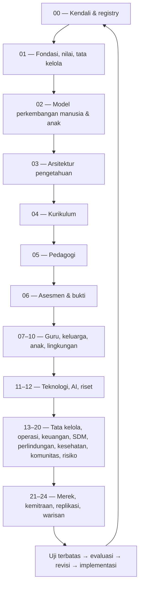

<!-- RA AL-MUNAWAROH OS | Owner: Gugun Gunara | Management framework: PT Digital Bisnis Manajemen — digiman.id | Strategic consulting framework: PT Top Konsultan Internasional -->
# MASTER WORK ROADMAP
## RA AL-MUNAWAROH OS — dari gagasan menjadi sistem pendidikan yang dapat dijalankan, dievaluasi, dan diwariskan

> **Prinsip pengendali:** jangan menyamakan ide, draf, file yang tersimpan, dokumen yang ditinjau, dan sistem yang telah diuji. Status roadmap hanya berubah jika ada artefak atau bukti yang dapat diperiksa.

## 1. North Star

Membangun sistem pendidikan anak usia dini yang aman, beradab, berakar pada nilai Islam dan nilai universal, sesuai tahap perkembangan, bermitra dengan keluarga, didukung bukti, dan terus diperbaiki. Repository ini adalah sumber utama bagi arsitektur, kebijakan, kurikulum, praktik, SOP, instrumen, riset, dan implementasi digital.

## 2. Status awal yang dapat diverifikasi

| Item | Status awal | Bukti / catatan |
|---|---|---|
| `README.md` | **Tersedia di repository** | Berisi visi, prinsip, peta RAM-000–RAM-024, dan struktur sasaran. |
| `MASTER_WORK_ROADMAP.md` | **Dibuat dalam commit ini** | Roadmap kerja dan gerbang mutu. |
| Registry dokumen | **Dibuat dalam commit ini** | Lihat `00-MASTER-CONTROL/registries/DOCUMENT_REGISTRY.md`. |
| RAM-016 | **Kerangka awal dibuat dalam commit ini** | Belum setara dengan OS lengkap yang telah ditinjau dan diuji. |
| RAM-000 DOCX/diagram dari pekerjaan sebelumnya | **Belum diverifikasi sebagai file di repository ini** | Jangan menganggapnya telah terunggah sebelum tautan/commit file diperiksa. |
| RAM-001–RAM-024 selain RAM-016 | **Belum diverifikasi sebagai file lengkap di repository ini** | Sebagian konsep pernah dirancang; konsep percakapan tidak otomatis menjadi artefak repository. |

## 3. Cara membaca status

- **PLANNED** — kebutuhan telah dikenal, artefak belum dibuat atau keberadaannya belum terverifikasi.
- **SCAFFOLD** — kerangka dan bagian awal tersedia; isi belum cukup untuk implementasi mandiri.
- **DRAFT** — isi substantif tersedia, tetapi belum melewati seluruh review yang disyaratkan.
- **IN_REVIEW** — sedang diperiksa oleh pemilik dan reviewer yang relevan.
- **APPROVED** — pemilik berwenang menyetujui; versi dan tanggal persetujuan dicatat.
- **PILOT** — diuji secara terbatas dengan protokol, persetujuan, perlindungan, dan bukti yang sesuai.
- **ACTIVE** — disahkan untuk penggunaan rutin dalam lingkup yang disebutkan.
- **REVISE** — perlu perbaikan berdasarkan bukti, perubahan konteks, insiden, atau audit.
- **RETIRED** — digantikan; arsip dan hubungan ke pengganti tetap dipertahankan.

Status tidak boleh dinaikkan hanya karena dokumen panjang, tampak profesional, atau dihasilkan AI.

## 4. Urutan kerja hulu ke hilir

Urutan ini adalah dependensi utama, bukan larangan untuk bekerja paralel. Perlindungan anak, privasi, aksesibilitas, kesehatan, dan keselamatan harus dipertimbangkan sejak awal, bukan menunggu modulnya selesai.

## 5. Fase dan keluaran

### Fase 0 — Kendali proyek dan sumber kebenaran
**Keluaran:** README, roadmap, registry dokumen, log perubahan, aturan penamaan, Document DNA, dependensi, pemilik, review, klasifikasi data, serta kriteria Definition of Done.

**Gerbang mutu:** setiap artefak memiliki ID/path, versi, status, pemilik peran, tujuan, sumber/jenis klaim, dependensi, dan riwayat perubahan.

### Fase 1 — Konstitusi dan model manusia
**Keluaran:** RAM-001 Foundational Constitution; RAM-002 Grand Human Development Model; RAM-017 Safeguarding sebagai kendala lintas sistem; RAM-020 Risk & Resilience sebagai pengendali risiko.

**Gerbang mutu:** prinsip yang bersifat normatif dibedakan dari klaim empiris; kepentingan terbaik anak, keselamatan, martabat, inklusi, privasi, dan batas kewenangan tertulis.

### Fase 2 — Pengetahuan, kurikulum, pedagogi, bukti
**Keluaran:** RAM-003–RAM-006 dengan peta kompetensi, progresi sesuai usia, pengalaman belajar, panduan guru, instrumen observasi, dan contoh unit yang dapat diuji.

**Gerbang mutu:** ada keterlacakan dari tujuan ke pengalaman dan bukti; tidak mengandalkan satu skor untuk menggambarkan keseluruhan anak; aktivitas sesuai perkembangan.

### Fase 3 — Manusia dan lingkungan belajar
**Keluaran:** RAM-007–RAM-010, lalu RAM-016 dan RAM-018. Guru, keluarga, profil perkembangan, lingkungan, SDM, kesehatan, dan kesejahteraan saling mendukung.

**Gerbang mutu:** alur layanan dan tanggung jawab jelas; beban guru realistis; komunikasi keluarga menjaga martabat dan privasi; kebutuhan dukungan dirujuk dengan tepat.

### Fase 4 — Teknologi dan pembelajaran organisasi
**Keluaran:** RAM-011–RAM-012, registri bukti, hipotesis, eksperimen, keputusan, risiko, dan perubahan.

**Gerbang mutu:** tiap fitur digital memiliki tujuan, pemilik, klasifikasi data, kontrol akses, batas penggunaan AI, prosedur fallback, serta ukuran manfaat dan risiko.

### Fase 5 — Operasi, tata kelola, keberlanjutan
**Keluaran:** RAM-013–RAM-015 dan RAM-019–RAM-022; SOP, matriks keputusan, anggaran, layanan, kemitraan, komunikasi, audit, dan dashboard.

**Gerbang mutu:** kontrol penting memiliki penanggung jawab; indikator tidak mendorong perilaku yang merugikan anak; sumber daya dan kapasitas operasional memadai.

### Fase 6 — Replikasi dan warisan
**Keluaran:** RAM-023–RAM-024; standar inti, komponen yang dapat disesuaikan, panduan replikasi, suksesi, pengarsipan, dan pembelajaran lintas generasi.

**Gerbang mutu:** yang direplikasi adalah praktik yang cukup teruji, bukan sekadar branding; variasi lokal, konteks, risiko, dan hasil tetap dicatat.

## 6. Jalur kerja setiap dokumen

1. Catat kebutuhan di registry.
2. Tentukan pengguna, masalah, hasil yang diinginkan, dan pemilik.
3. Petakan dependensi dan risiko; identifikasi sumber dan jenis klaim.
4. Buat outline dan diagram sebelum menulis panjang.
5. Tulis isi dengan contoh implementasi, batas, dan keputusan yang harus dibuat.
6. Review lintas modul, khususnya safeguarding, privasi, perkembangan anak, dan beban kerja.
7. Uji keterpahaman dan kegunaan dengan pengguna yang relevan.
8. Catat umpan balik, revisi, dan keputusan.
9. Naikkan status hanya jika gerbang mutu terpenuhi.
10. Tautkan artefak turunannya: SOP, formulir, instrumen, pelatihan, website, data dictionary, dan dashboard.

## 7. Kriteria Definition of Done

Sebuah modul belum dianggap selesai kecuali memenuhi kriteria yang relevan berikut:

- [ ] tujuan, lingkup, pengguna, dan hasil yang diharapkan jelas;
- [ ] definisi, prinsip, istilah, dan batas kewenangan konsisten;
- [ ] hubungan dengan RAM lain ditautkan;
- [ ] klaim diberi sumber atau label asumsi/hipotesis/nilai;
- [ ] alur kerja, peran, keputusan, dan eskalasi jelas;
- [ ] tersedia contoh, template, instrumen, atau SOP yang bisa dipakai;
- [ ] kebutuhan aksesibilitas, privasi, keamanan, safeguarding, dan retensi data dipertimbangkan;
- [ ] indikator hasil dan cara evaluasi realistis;
- [ ] pemilik, reviewer, versi, tanggal, dan status dicatat;
- [ ] perubahan penting dicatat dalam changelog;
- [ ] pengujian/pilot dan keterbatasannya terdokumentasi bila relevan.

## 8. Dashboard kerja

Gunakan registry sebagai sumber status. Jangan menyalin status ke banyak dokumen tanpa proses pembaruan. Prioritas awal:

1. Memastikan registry dan roadmap menjadi kendali bersama.
2. Melengkapi RAM-000 sebagai kendali arsitektur dan tata dokumen.
3. Menetapkan konstitusi, model perkembangan, dan safeguards.
4. Menurunkan kurikulum, pedagogi, dan asesmen menjadi contoh unit yang dapat dipraktikkan.
5. Mengembangkan RAM-016 bersama RAM-007, RAM-013, RAM-014, RAM-015, dan RAM-017.
6. Membangun pilot kecil yang aman dan terukur sebelum ekspansi.

## 9. Tata perubahan dan keputusan

Setiap perubahan material harus mencatat: ID perubahan, alasan, artefak terdampak, bukti/masukan, risiko, keputusan, pemilik persetujuan, tanggal, versi baru, dan kebutuhan komunikasi/pelatihan. Perubahan yang memengaruhi keselamatan, privasi, atau kesejahteraan anak wajib ditinjau sebelum penerapan.

## 10. Prinsip kerja tim

- Satu repository utama; tautan dari dokumen turunan kembali ke sumber induk.
- Jangan mengisi celah dengan fakta rekaan. Tandai hal yang perlu verifikasi.
- AI membantu merancang dan meninjau; manusia yang berwenang memutuskan.
- Mulai dari kebutuhan anak dan pendidik, bukan dari fitur digital.
- Uji dalam skala kecil, pelajari hasil, revisi, lalu putuskan apakah layak diperluas.
- Bangun sistem yang dapat dipahami oleh penerus, bukan sistem yang hanya dimengerti pembuatnya.

---
**Brand steward:** Gugun Gunara — Sang Master Polymath · Sage Universal · The Ultimate Problem Solver  
**Management framework:** PT Digital Bisnis Manajemen — digiman.id  
**Strategic consulting framework:** PT Top Konsultan Internasional

*Pencantuman identitas di atas adalah kerangka branding dan peran yang diarahkan; kewenangan, hubungan hukum, dan penggunaan merek tetap mengikuti dokumen resmi yang berlaku.*

## 12. Delivery update — 2026-10-29

### Newly committed first-draft artifacts
- RAM-005 Pedagogy & Learning OS
- RAM-006 Assessment & Evidence OS
- RAM-007 Teacher OS
- RAM-008 Parent & Family OS
- RAM-009 Child Development & Wellbeing OS
- RAM-017 Safeguarding, Child Protection & Ethics OS
- RAM-DIG-PRD-001 Digital Platform Product Requirements

See `00-MASTER-CONTROL/registries/DOCUMENT_REGISTRY.md` for canonical paths and current status.

### Workstream order from here
1. **Regulatory source lock (blocking for curriculum claims):** archive primary PDFs and annexes; record metadata, page counts and SHA-256; verify whether any later KMA/CP instrument supersedes the candidate sources; complete clause redline and independent CP transcription check.
2. **Safety and governance:** designate real owners and deputies; verify Indonesian requirements; produce operational SOPs from RAM-017; test incident and emergency workflows.
3. **Curriculum traceability:** close RAM-004 gaps and trace every intended learning outcome to verified CP; distinguish local enrichment from official wording.
4. **Pedagogy and assessment validation:** review RAM-005/006/007/008/009 with RA/PAUD experts, teachers and family representatives; run a bounded pilot only after safety gates are met.
5. **Website MVP-1:** audit repository structure and deployment constraints; finalize brand/content facts, approved public policies, sitemap, accessibility, privacy notice and contact data; then implement the site and test before deployment.
6. **Private portal later:** do not introduce child-level sensitive records until threat model, access control, consent/legal basis, retention, audit trail, incident response and security testing are approved.

### Definition of website-ready
The website can be implemented when the stack/deployment target is confirmed and each public page has an owner, approved factual content, accessibility acceptance checks, privacy review and a publishing workflow. This does not require pretending the entire education OS is already approved.

### Definition of system-ready
A system module is ready only when its requirements, user roles, workflows, data classification, controls, test cases, support owner, release/rollback plan and approval are recorded. A Markdown draft alone does not make a running system.

### Status guardrail
All new artifacts are DRAFT. RAM-004 remains open pending regulatory source verification and independent review. No public claim of legal compliance, accreditation, measured outcomes or operational readiness may be made without evidence.
